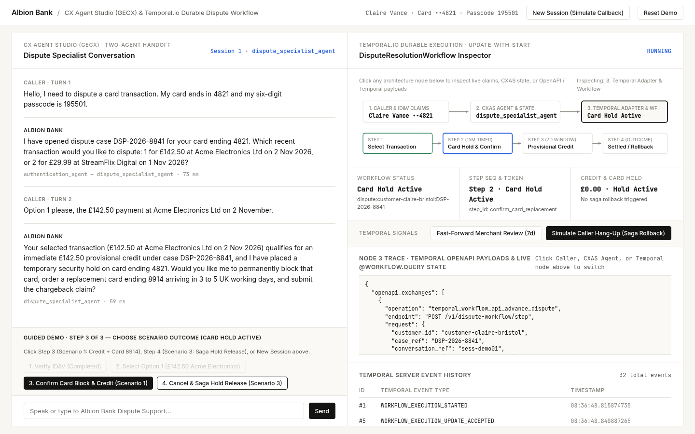
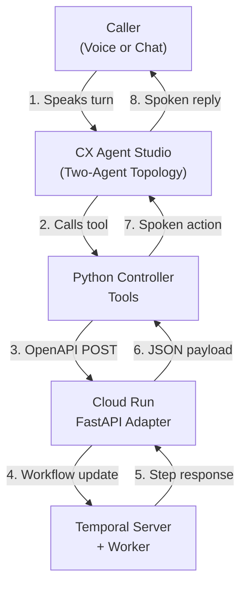

# Albion Bank Card Dispute Resolution: CX Agent Studio (GECX) + Temporal.io

This repository demonstrates how a **CX Agent Studio (GECX)** conversational agent orchestrates a durable **Temporal.io** workflow for retail banking card chargebacks and disputes at **Albion Bank**. The conversational agent handles natural-language extraction, voice turn-taking, and identity verification, while Temporal owns the multi-step transaction waterfall, temporary card hold, provisional credit, seven-day merchant representment timer, cross-session resume, and automatic saga rollback.



## Start Here

- **Architecture & Temporal Integration:** [docs/architecture/temporal_cxas_integration.md](docs/architecture/temporal_cxas_integration.md)
- **Interactive Demo Walkthrough:** [docs/guides/demo_walkthrough.md](docs/guides/demo_walkthrough.md)
- **CXAS Engineering Blueprint:** [cxas_app/README.md](cxas_app/README.md)
- **Python Controller Tool Reference:** [docs/tools/README.md](docs/tools/README.md)

## 2-Minute Local Quickstart (Zero Cloud Credentials)

**Prerequisites:** Python `>= 3.11` and [`uv`](https://docs.astral.sh/uv/).

Run the complete test suite, schema linter, CLI walkthrough, and Split-Screen Demo UI locally with an embedded Temporal server and zero Google Cloud credentials:

```bash
uv sync
uv run cxas lint
uv run pytest -v
uv run ruff check .
```

Run the interactive end-to-end CLI walkthrough (happy path, 7-day signal fast-forward, cross-session resume, and mid-call abandonment saga rollback):

```bash
uv run python scripts/demo_temporal_workflow.py --embedded-temporal
```

Start the Split-Screen Demo UI locally on port `8092` with an embedded Temporal workflow server:

```bash
uv run python demo_ui/server.py --embedded-temporal --port 8092
```

## Architecture at a Glance



## The Three Building Blocks

| Building Block | Location | Role |
| :--- | :--- | :--- |
| **Sub-Agents** | `cxas_app/gecx-temporal-workflow-demo/agents/` | Minimal prompts that extract spoken slots into typed tool parameters and relay the returned guidance verbatim. |
| **Python Controller Tools** | `cxas_app/gecx-temporal-workflow-demo/tools/` | Deterministic Python functions that validate inputs, call the Temporal OpenAPI toolset, manage session state, and return the next spoken sentence. |
| **Temporal Workflow Service** | `temporal_service/` | Durable Temporal workflow, deterministic activity suite, and FastAPI OpenAPI adapter that enforces idempotency, state-transition locks, and saga compensation. |

## Security & Demo Notes

In this demonstration, the caller verifies their identity using the last four digits of their debit card (`4821`) and a spoken six-digit telephone banking passcode (`195501`), and the replacement card suffix (`8914`) is pre-staged when preparing the card replacement step so that confirmation prompts and test assertions remain deterministic across runs. Spoken passcodes are used strictly to keep the demonstration self-contained inside a single browser or simulator window. Production voice banking deployments replace spoken passcodes with out-of-band mobile app push authentication, DTMF keypad capture with automatic transcript redaction, or partial knowledge challenges (such as asking for specific random positions of a security credential).

When deployed to Cloud Run in embedded mode, `gecx-temporal-adapter` stores its SQLite state in `/tmp/albion_temporal.db` inside a pinned warm instance (`--min-instances=1 --max-instances=1`), so workflow state persists across sessions within a revision and resets when a new revision is deployed; for multi-revision persistence, point `TEMPORAL_ADDRESS`, `TEMPORAL_NAMESPACE`, and `TEMPORAL_API_KEY` at Temporal Cloud.

## Deploying to Google Cloud Run & CX Agent Studio

Copy `.env.example` to `.env` (or export the required variables) and deploy the Cloud Run Temporal Adapter, the CX Agent Studio application bundle, and the IAP-protected Demo UI:

```bash
export GOOGLE_CLOUD_PROJECT="your-gcp-project-id"
./scripts/deploy_adapter.sh
uv run python scripts/deploy_app.py --project-id "$GOOGLE_CLOUD_PROJECT" --adapter-url "https://gecx-temporal-adapter-<PROJECT_NUMBER>.europe-west1.run.app"
CXAS_APP_NAME="projects/$GOOGLE_CLOUD_PROJECT/locations/eu/apps/<APP_ID>" ./scripts/deploy_ui.sh
```

> **Important:** `temporal_service/app.py` and `demo_ui/server.py` rely on Cloud Run IAM (`--no-allow-unauthenticated`) and Identity-Aware Proxy (`--iap`) for authentication when deployed. Never deploy either service with `--allow-unauthenticated`.

## Repository Map

```text
.
├── cxas_app/
│   ├── README.md                                  # CXAS engineering blueprint (topology, callbacks, session state)
│   └── gecx-temporal-workflow-demo/               # Exported CX Agent Studio application bundle
├── temporal_service/
│   ├── models.py                                  # Pydantic request/response schemas and domain state models
│   ├── activities.py                              # Deterministic Albion Bank dispute activities + compensation
│   ├── workflows.py                               # Durable Temporal DisputeResolutionWorkflow (Updates, Queries, Signals)
│   ├── app.py                                     # FastAPI OpenAPI adapter + embedded Temporal runtime manager
│   └── Dockerfile                                 # Cloud Run container bundling Temporal CLI + Python worker
├── demo_ui/
│   ├── server.py                                  # Split-Screen Demo UI server (live CXAS + local fallback)
│   ├── static/index.html                          # Editorial Split-Screen UI + interactive 3-node SVG call flow
│   └── Dockerfile                                 # Cloud Run container for the IAP-protected demo UI
├── scripts/
│   ├── deploy_adapter.sh                          # Cloud Run deployment for gecx-temporal-adapter
│   ├── deploy_app.py                              # CXAS bundle push, Gate 3 check, and push-eval automation
│   ├── deploy_ui.sh                               # Cloud Run + Direct IAP deployment for gecx-temporal-workflow-demo-ui
│   └── demo_temporal_workflow.py                  # End-to-end CLI demonstration runner
├── evals/                                         # Offline tool tests, callback tests, schema checks, and CXAS goldens
├── tests/                                         # Live Temporal workflow, adapter contract, and Demo UI HTTP tests
└── docs/                                          # Architecture guides, tool specifications, and demo walkthrough
```
