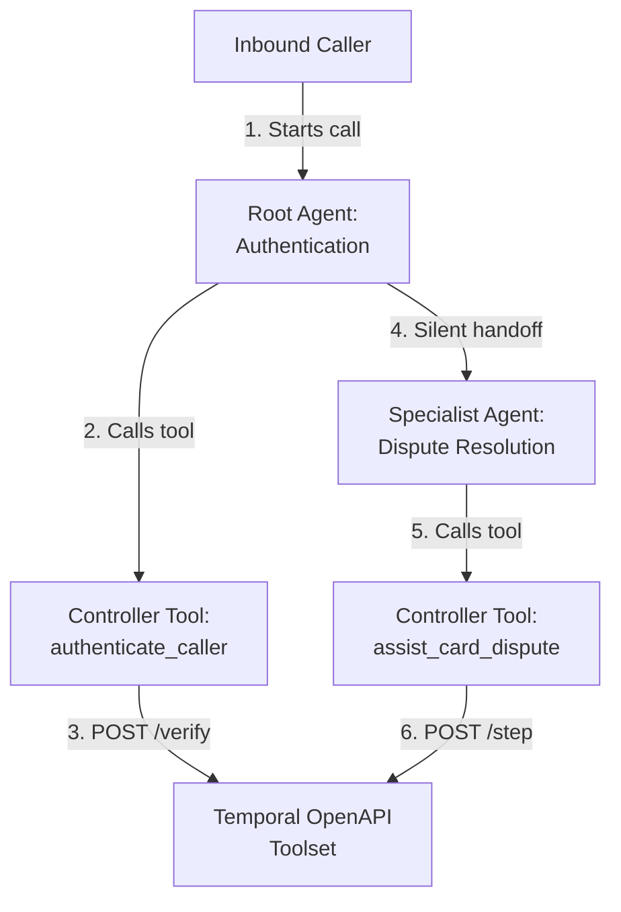
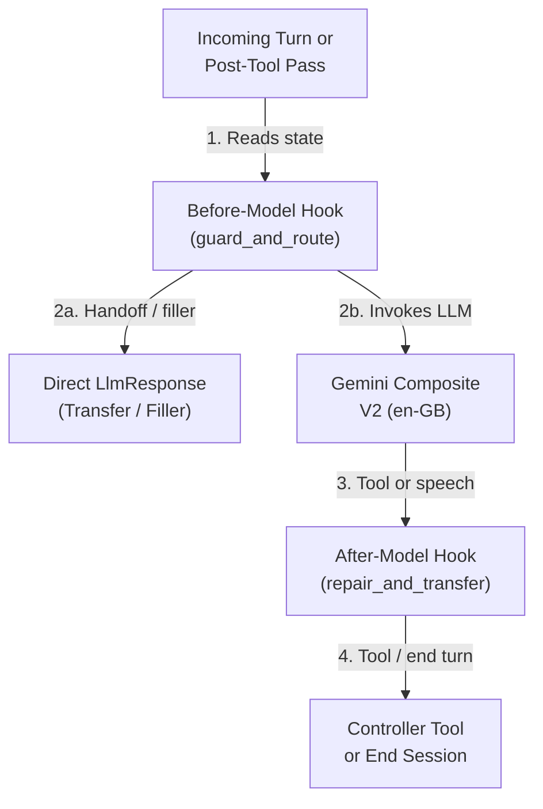
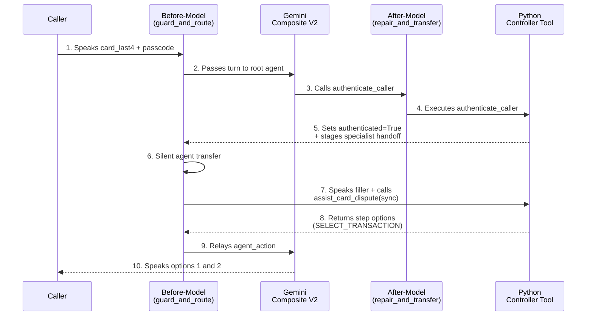

# CX Agent Studio (GECX) Engineering Blueprint

This document describes the architecture, sub-agent topology, callback lifecycle, session state schema, and verification pyramid for the **Albion Bank Card Dispute Resolution** CX Agent Studio (GECX) application located in `cxas_app/gecx-temporal-workflow-demo/`.

## 1. Two-Agent Handoff Topology

The application splits caller identity verification from durable workflow execution across two specialist sub-agents. Each sub-agent pairs a minimal instruction prompt with one deterministic Python controller tool and shared before-model and after-model callbacks.

### Micro-Agent Anatomy

## 2. Agents and Tools Inventory

| Sub-Agent | Role | Controller Tool | Downstream Target |
| :--- | :--- | :--- | :--- |
| `authentication_agent` | Root agent. Verifies the caller's debit card last four digits and six-digit telephone banking passcode before opening account records. | `authenticate_caller` | `dispute_specialist_agent` |
| `dispute_specialist_agent` | Specialist agent. Drives the customer's durable Temporal card dispute workflow using the generic `assist_card_dispute(operation="sync" \| "submit" \| "cancel")` step-driver tool. | `assist_card_dispute` | `authentication_agent` (if unauthenticated) |

## 3. Turn Lifecycle and Callback Chain

Every sub-agent executes the same deterministic callback pair on each pass:

| Callback | Hook | Execution Order & Responsibility |
| :--- | :--- | :--- |
| `guard_and_route` | `before_model_callback` | 1. Seeds `session_state["conversation_ref"]` from `session_id` if unset. 2. On a post-tool pass where `session_state["target_agent"]` is set, clears `target_agent` and emits `Part.from_agent_transfer` to switch agents silently. 3. On `dispute_specialist_agent`, redirects back to `authentication_agent` if `session_state["authenticated"]` is not `True`. 4. When `session_state["pending_dispute_init"]` is `True`, clears the flag and returns a combined `LlmResponse` containing a short spoken filler plus a `FunctionCall` to `assist_card_dispute(operation="sync")`. |
| `repair_and_transfer` | `after_model_callback` | 1. Passes model tool calls through unchanged. 2. Appends `Part.from_end_session` when `session_state["call_complete"] == "true"` after the final spoken response and marks `call_complete = "released"`. |

## 4. Session State Schema

All session state is consolidated into a single top-level variable named `session_state` (`"type": "OBJECT"`, `"required": []`) declared in `app.json`. Tools and callbacks read `session = dict(context.state.get("session_state") or {})` and write updates back via `context.state["session_state"] = session` using native Python types:

| Key inside `session_state` | Python Type | Writer | Reader | Purpose |
| :--- | :--- | :--- | :--- | :--- |
| `authenticated` | `bool` | `authenticate_caller` | Both tools, `guard_and_route` | Indicates whether caller identity verification has succeeded. |
| `auth_attempts` | `int` | `authenticate_caller` | `authenticate_caller` | Tracks consecutive failed verification attempts (locks at `2`). |
| `customer_id` | `str` | Session seed / `authenticate_caller` | Both tools | Canonical customer identifier (`customer-claire-bristol`). |
| `customer_name` | `str` | `authenticate_caller` | Both tools | Verified customer full name (`Claire Vance`). |
| `has_active_case` | `bool` | `authenticate_caller`, `assist_card_dispute` | `assist_card_dispute` | `True` when an existing dispute case is detected at verification; passed as `is_session_resume=True` on initial `sync` and then cleared to `False`. |
| `workflow_id` | `str` | `assist_card_dispute` | `assist_card_dispute`, Demo UI | Active Temporal workflow ID (`dispute:customer-claire-bristol:DSP-2026-8841`). |
| `case_ref` | `str` | Both tools | Both tools | Human-readable Albion Bank dispute reference (`DSP-2026-8841`). |
| `conversation_ref` | `str` | `guard_and_route`, `assist_card_dispute` | `assist_card_dispute` | Stable conversation identifier used to construct idempotent Temporal `update_id` keys. |
| `expected_step_id` | `str` | `assist_card_dispute` | `assist_card_dispute` | Current Temporal workflow step (`select_transaction`, `confirm_card_replacement`, etc.) passed for optimistic concurrency checks. |
| `expected_input_kind` | `str` | `assist_card_dispute` | `assist_card_dispute` | Expected caller input kind (`NONE`, `OPTION_SELECT`, `CONFIRMATION`, or `FREE_TEXT`) for the active workflow step. |
| `reprompt_guidance` | `str` | `assist_card_dispute` | `assist_card_dispute` | Step-specific re-prompt spoken when caller input validation fails (`HTTP 422` or local mismatch). |
| `workflow_status` | `str` | `assist_card_dispute` (`session_vars`) | Demo UI, evals | High-level Temporal workflow status enum (`SELECT_TRANSACTION`, `CONFIRM_CARD_REPLACEMENT`, etc.). |
| `pending_workflow_options` | `list[str]` | `assist_card_dispute` | `assist_card_dispute` | List of numbered option strings for option resolution. |
| `pending_in_progress_args` | `dict` | `assist_card_dispute` | `assist_card_dispute` | Request payload dictionary cached when an update returns `status="IN_PROGRESS"` so the next turn retries the exact same `update_id`. |
| `card_hold_active` | `bool` | `assist_card_dispute` (`session_vars`) | Demo UI, evals | Indicates whether a temporary security hold is active on the caller's card. |
| `provisional_credit_gbp` | `str` | `assist_card_dispute` (`session_vars`) | Demo UI, evals | Formatted GBP provisional credit amount (`"142.50"` or `"29.99"`). |
| `target_agent` | `str` | Both tools | `guard_and_route`, `repair_and_transfer` | Stages a silent handoff to another sub-agent on the next callback pass. |
| `pending_dispute_init` | `bool` | `authenticate_caller` | `guard_and_route`, `assist_card_dispute` | Triggers the automatic pre-tool filler and `operation="sync"` call upon entering `dispute_specialist_agent`. |
| `escalation_reason` | `str` | Both tools | Evals, Demo UI | Records terminal escalation reason (`AUTH_LOCKED` or `SYSTEM_ERROR`). |
| `call_complete` | `str` | Both tools | `guard_and_route`, `repair_and_transfer`, Evals | `"true"` when `DisputeStepResponse.end_conversation` is `True` or escalation occurs; `"released"` after `Part.from_end_session` is emitted. |

## 5. Testing Pyramid

| Layer | Command | Scope |
| :--- | :--- | :--- |
| **1. Schema & AST Hygiene** | `uv run cxas lint && uv run pytest evals/test_app_schema.py` | Validates CXAS bundle schema, callback parity across sub-agents, AST rules, and Pydantic parity between `toolFakeConfig` and `temporal_service/models.py`. |
| **2. Offline Controller & Callback Unit Tests** | `uv run pytest evals/tool_tests evals/callback_tests` | Tests every branch of `authenticate_caller`, `assist_card_dispute` (`409` resync, `422` re-prompt, `IN_PROGRESS` retry, cross-session resume, `session_vars` guard), and callbacks. |
| **3. Live Temporal Workflow & Adapter Contract Tests** | `uv run pytest tests/` | Runs a real local Temporal server (`WorkflowEnvironment.start_time_skipping`), exercises the FastAPI OpenAPI adapter, verifies controller-to-adapter wire compatibility, and tests the Split-Screen Demo UI HTTP server. |
| **4. Platform Goldens & Simulations** | `uv run cxas run` | Executes multi-turn golden evaluations (`evals/goldens/goldens.yaml`) and goal-oriented simulations (`evals/simulations/simulations.yaml`) against the deployed CXAS app. |
