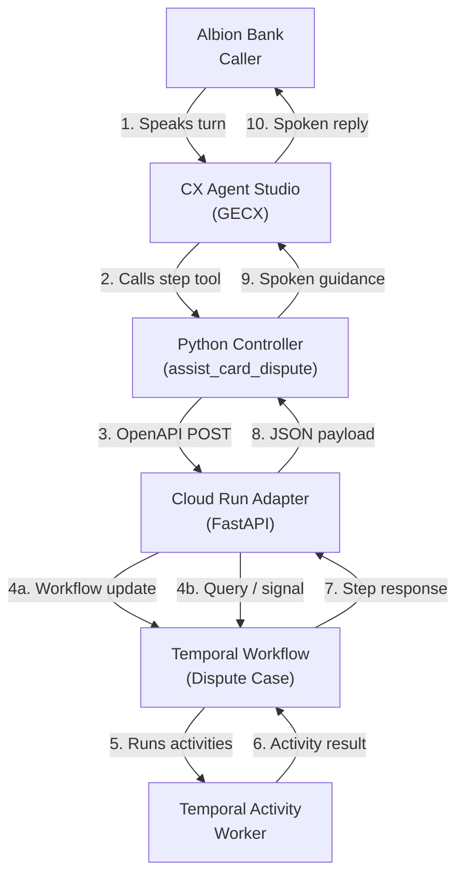
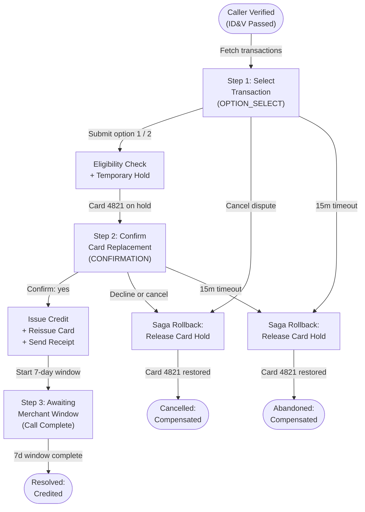

# Temporal.io + CX Agent Studio (GECX) Integration Architecture

## 1. Architectural Overview

Conversational voice and chat sessions in **CX Agent Studio (GECX)** are request-response loops bound to a live telephone call or chat window, whereas retail banking operations at **Albion Bank** frequently span multiple systems, asynchronous compliance timers, and multi-day settlement windows. Pairing CX Agent Studio with **Temporal.io** separates the conversational front end from durable process execution:

- **CX Agent Studio (GECX)** manages real-time speech recognition, semantic slot extraction, caller identity verification, turn-taking filler speech, and natural British English synthesis via a generic step-driver tool (`assist_card_dispute`).
- **Temporal.io** manages the durable state machine (`DisputeResolutionWorkflow`), step-level input contracts (`input_kind`, `reprompt_guidance`, `end_conversation`, and `session_vars`), deterministic activity retries, optimistic concurrency checks, seven-day merchant representment timers, cross-session state rehydration, and compensating saga rollbacks.

## 2. Five-Pattern Integration Contract

Connecting a synchronous conversational turn to an asynchronous workflow engine requires five architectural guardrails between the CXAS Python controller tools and the Temporal FastAPI adapter:

| Pattern | Mechanism | Why It Matters for Voice & Chat Agents |
| :--- | :--- | :--- |
| **1. Generic Step-Driver Protocol** | `@workflow.update` (`submit_step`) with `operation: "sync" \| "submit" \| "cancel"` | Decouples the CXAS Python tool from workflow-specific step names or terminal status lists. Each `DisputeStepResponse` declares `input_kind` (`NONE`, `OPTION_SELECT`, `CONFIRMATION`, `FREE_TEXT`), `reprompt_guidance`, `end_conversation`, and `session_vars`. |
| **2. Optimistic Concurrency & Validation** | `@submit_step.validator` (`validate_submit_step`) | Validates that the caller's `expected_step_id` matches the workflow's current step and that inputs match the active step's `input_kind` before mutating state. Stale steps return `HTTP 409` so the controller automatically resynchronizes. |
| **3. Deterministic Update Idempotency** | `update_id` derived from conversation, step, and canonical args | Prevents duplicate card holds, duplicate provisional credits, or double state transitions when an HTTP client or LLM tool-call loop retries the same turn. |
| **4. Latency Budget & Graceful Fallback** | `2.5s` adapter wait budget (`IN_PROGRESS` envelope) | Ensures the FastAPI adapter responds before the CXAS OpenAPI tool timeout. If an activity is still running, the adapter returns `status="IN_PROGRESS"` and the controller caches the payload so the next turn joins the exact same `update_id`. |
| **5. Cross-Session Rehydration** | Deterministic `workflow_id` per customer and case + `is_session_resume` | Allows a caller to hang up while the workflow is running and call back later in a brand-new CXAS session, immediately resuming the live workflow state with a server-generated welcome-back banner. |

## 3. DisputeResolutionWorkflow State Machine

The Albion Bank card dispute workflow progresses through six deterministic states:

## 4. Activity Waterfall and Saga Compensation

Each step in `DisputeResolutionWorkflow` delegates external side effects to deterministic Temporal activities defined in `temporal_service/activities.py`:

| Activity | Step Trigger | Side Effect | Compensation Action |
| :--- | :--- | :--- | :--- |
| `fetch_disputable_transactions` | Workflow start (`run`) | Loads settled transactions for the verified customer (`£142.50 at Acme Electronics Ltd on 2 Nov 2026` and `£29.99 at StreamFlix Digital on 1 Nov 2026`). | Read-only (none required). |
| `evaluate_chargeback_eligibility` | `select_transaction` (`operation="submit"`) | Evaluates Visa scheme chargeback rule (`13.1` Merchandise / Services Not Received or `13.2` Cancelled Recurring Transaction) and duplicate claim checks. | Read-only (none required). |
| `stage_temporary_card_hold` | `select_transaction` (`operation="submit"`) | Places a reversible security hold on debit card ending `4821`. | Rolled back by `release_temporary_card_hold` if the caller cancels, declines replacement, or hangs up before chargeback filing. |
| `issue_provisional_credit_and_reissue_card` | `confirm_card_replacement` (`confirmed="yes"`) | Credits `£142.50` or `£29.99` to the customer's Albion Bank account, permanently blocks card `4821`, and orders replacement card ending `8914`. | If this activity raises `ActivityError`, `_finish_abandoned_or_cancelled` runs `release_temporary_card_hold`. |
| `send_outbound_dispute_receipt` | `confirm_card_replacement` (`confirmed="yes"`) | Dispatches an out-of-band SMS and email confirmation receipt for the provisional credit and replacement card order. | Idempotent notification activity. |
| `release_temporary_card_hold` | `operation="cancel"`, `confirmed="no"`, `caller_abandoned`, or 15-minute timeout | Removes the temporary security hold on card `4821` and records `saga_compensated=True` in `SIDE_EFFECT_LEDGER` and workflow state. | Terminal compensation step. |

## 5. Cloud Run Authentication and OpenAPI Boundary

When deployed to Google Cloud:

1. The FastAPI adapter (`gecx-temporal-adapter`) runs on Cloud Run in `europe-west1` with `--no-allow-unauthenticated` and `--min-instances=1` so the embedded Temporal server and Python worker remain warm across calls.
2. At deployment time, `cxas_app/gecx-temporal-workflow-demo/environment.json` is configured with the deployed Cloud Run URL. Because CX Agent Studio `google_id_token` authentication sets the JWT `aud` claim to the full request URL (including path), the Cloud Run service registers custom audiences for both the base service URL and the two OpenAPI operation paths (`/v1/dispute-workflow/verify` and `/v1/dispute-workflow/step`).
3. Offline `NAIVE` evaluations and unit tests bypass network calls entirely using the stateful Python `toolFakeConfig` in `cxas_app/gecx-temporal-workflow-demo/toolsets/temporal_workflow_api/tool_fake_config/code_block/python_code.py`, which is validated against the adapter's Pydantic models in `evals/tool_tests/test_controllers.py`.
