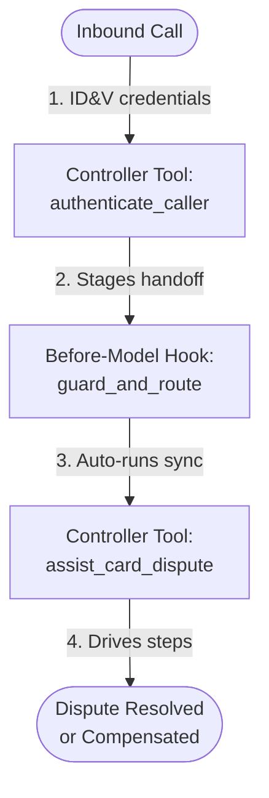

# Python Controller Tools Index

Every sub-agent in the Albion Bank CX Agent Studio (GECX) application calls a single deterministic Python controller tool. The LLM never calls the raw OpenAPI toolset operations directly; instead, the Python controller validates inputs, calls the `temporal_workflow_api` OpenAPI toolset, updates session state, and returns a single-key `{"agent_action": ...}` dictionary.

## 1. Controller Tool Progression

## 2. Tool Specifications and Source Line Index

| Tool Name | Owning Sub-Agent | Specification | Source Implementation |
| :--- | :--- | :--- | :--- |
| `authenticate_caller` | `authentication_agent` | [authenticate_caller.md](authenticate_caller.md) | [python_code.py](../../cxas_app/gecx-temporal-workflow-demo/tools/authenticate_caller/python_function/python_code.py#L1-L239) |
| `assist_card_dispute` | `dispute_specialist_agent` | [assist_card_dispute.md](assist_card_dispute.md) | [python_code.py](../../cxas_app/gecx-temporal-workflow-demo/tools/assist_card_dispute/python_function/python_code.py#L1-L464) |
