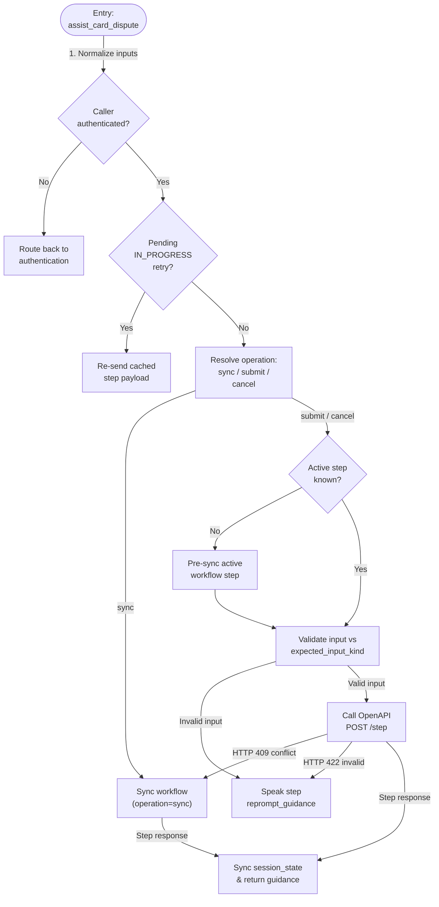

# Tool Specification: `assist_card_dispute`

- **Owning Sub-Agent:** `dispute_specialist_agent`
- **Source Implementation:** [python_code.py](../../cxas_app/gecx-temporal-workflow-demo/tools/assist_card_dispute/python_function/python_code.py#L1-L464)
- **OpenAPI Toolset Operation:** `tools.temporal_workflow_api_advance_dispute` (`POST /v1/dispute-workflow/step`)

## 1. Overview and Architectural Principles

The `assist_card_dispute` tool is a generic, workflow-agnostic step driver for starting, resuming, and advancing the customer's durable Temporal `DisputeResolutionWorkflow`. All step-specific business logic, prompts, re-prompts, option lists, session variable projections, and completion rules live inside the Temporal workflow (`DisputeStepResponse`), while the Python controller tool acts as a generic conversational step driver.

Core invariants:

- **Authentication Guard:** If `session_state["authenticated"]` is not `True`, the tool stages `session_state["target_agent"] = "authentication_agent"` and returns a verification prompt without touching the Temporal API.
- **Generic Step-Driver Signature:** The tool accepts only generic conversational parameters (`operation`, 1-based `option_index`, spoken `option_text`, `confirmed` token `"yes"`/`"no"`, and `input_text`). It never hardcodes terminal status lists (`_TERMINAL_STATUSES`), step-specific handler functions (`_run_select_transaction`, `_run_confirm_replacement`), or raw backend transaction IDs (`TX-90412`).
- **`IN_PROGRESS` Retry Deduplication:** If the Temporal FastAPI adapter hits its `2.5s` execution budget and returns `status="IN_PROGRESS"`, `_apply_step_response` caches the exact request payload dictionary in `session_state["pending_in_progress_args"]`. On the caller's next status-check turn, `_retry_in_progress_request` replays that exact payload so the adapter reconstructs the same `update_id` and joins the in-flight Temporal update.
- **Stale Step (`HTTP 409`) Resynchronization:** If `session_state["expected_step_id"]` is out of sync with the live Temporal workflow (for example, after an external signal advanced the workflow), `_call_step_api` detects `HTTP 409` and automatically invokes `_sync_workflow` to refresh `session_state` and speak the live workflow step.
- **Server-Owned Cross-Session Resume Greeting:** When `session_state["has_active_case"]` is `True` (set by `authenticate_caller` when a returning caller already has an active `RUNNING` dispute), `_sync_workflow` passes `is_session_resume=True` to the Temporal adapter, which prepends `"Welcome back, Claire Vance. Resuming active dispute case DSP-2026-8841."` to the live step guidance.
- **Unrestricted `session_vars` Projection:** `_sync_state_from_response` merges `DisputeStepResponse.session_vars` directly into `session_state` (`session.update(body.get("session_vars") or {})`), allowing the Temporal workflow to set or override any key inside `session_state`.

## 2. Complete Workflow Flowchart



## 3. Tool Signature and Parameters

```python
def assist_card_dispute(
    operation: Literal["", "sync", "submit", "cancel"] = "",
    option_index: int = 0,
    option_text: str = "",
    confirmed: Literal["", "yes", "no"] = "",
    input_text: str = "",
) -> dict:
```

| Parameter | Type | Required | Description |
| :--- | :--- | :--- | :--- |
| `operation` | `Literal` | No | Generic workflow step operation (`""`, `"sync"`, `"submit"`, or `"cancel"`). |
| `option_index` | `int` | No | 1-based numbered option chosen by the caller (`1` or `2`), or `0` when not selecting an option. |
| `option_text` | `str` | No | Option label or merchant name spoken by the caller when selecting an option, such as `"Acme Electronics Ltd"` or `"StreamFlix Digital"`. |
| `confirmed` | `Literal` | No | Caller confirmation token (`""`, `"yes"`, or `"no"`) when responding to a yes/no confirmation step. |
| `input_text` | `str` | No | Free-text caller input when responding to an open-ended step. |

## 4. Sub-Flow Details and Session State Reads/Writes

### Helper Functions

- `_resolve_operation(operation, option_index, option_text, confirmed, input_text)`: Determines the generic workflow operation (`"sync"`, `"submit"`, or `"cancel"`) from the tool arguments.
- `_execute_workflow_step(session, ...)`: Pre-syncs if `session["expected_step_id"]` is empty, validates the caller's input against `session["expected_input_kind"]` (`"OPTION_SELECT"`, `"CONFIRMATION"`, `"FREE_TEXT"`, or `"NONE"`), sends the generic `AdvanceDisputeRequest` payload, and handles `409` auto-resync and `422` re-prompting.
- `_sync_workflow(session, customer_id, case_ref, conv_ref)`: Calls `operation="sync"` on the Temporal adapter with `is_session_resume=bool(session.get("has_active_case"))`.
- `_resolve_option_index(session, option_index, option_text)`: Matches a 1-based option index or spoken substring against `session["pending_workflow_options"]`.
- `_sync_state_from_response(session, body)`: Persists `workflow_id`, `case_ref`, `expected_step_id`, `expected_input_kind`, `reprompt_guidance`, `pending_workflow_options`, all keys in `session_vars` directly into `session_state`, and `call_complete = "true"` when `end_conversation` is `True`.
- `_retry_in_progress_request(session, saved_payload)`: Re-sends a cached `IN_PROGRESS` payload dictionary so the adapter joins the same `update_id`.
- `_infer_error_code(err_body, status_code)`: Extracts `HTTP 409` or `HTTP 422` from either raw HTTP status codes or platform-wrapped error strings.

### `session_state` (`OBJECT`) Reads and Writes

| Key inside `session_state` | Direction | Purpose |
| :--- | :--- | :--- |
| `authenticated` | Read | Verifies that caller ID&V succeeded before calling Temporal. |
| `customer_id` | Read | Customer identifier (`"customer-claire-bristol"`). |
| `has_active_case` | Read / Write | Passed as `is_session_resume=True` on `sync` when `True`, then cleared to `False` once a non-`IN_PROGRESS` response is applied. |
| `conversation_ref` | Read / Write | Passed in every `AdvanceDisputeRequest` so the adapter derives a deterministic `update_id`. |
| `workflow_id` | Write | Synced from `DisputeStepResponse.workflow_id`. |
| `case_ref` | Read / Write | Synced from `DisputeStepResponse.case_ref` (`"DSP-2026-8841"`). |
| `expected_step_id` | Read / Write | Passed on `submit`/`cancel` for optimistic concurrency validation and updated from every response. |
| `expected_input_kind` | Read / Write | Synced from `DisputeStepResponse.input_kind` (`"NONE"`, `"OPTION_SELECT"`, `"CONFIRMATION"`, or `"FREE_TEXT"`). |
| `reprompt_guidance` | Read / Write | Synced from `DisputeStepResponse.reprompt_guidance` and spoken when input validation fails. |
| `pending_workflow_options` | Read / Write | Native Python `list[str]` of numbered option strings used by `_resolve_option_index`. |
| `pending_in_progress_args` | Read / Write | Native Python `dict` request payload saved when `status == "IN_PROGRESS"` and cleared on completion. |
| `workflow_status` | Write | Synced dynamically via `DisputeStepResponse.session_vars`. |
| `card_hold_active` | Write | Synced dynamically via `DisputeStepResponse.session_vars`. |
| `provisional_credit_gbp` | Write | Synced dynamically via `DisputeStepResponse.session_vars`. |
| `call_complete` | Write | Set to `"true"` when `DisputeStepResponse.end_conversation` is `True`. |

> **Extension Checklist for New `session_vars` Keys:** Because all session state is consolidated inside the single `session_state` (`type: "OBJECT"`) variable in `app.json` and `_sync_state_from_response` merges `body.get("session_vars")` directly into `session_state`, any new domain key emitted inside `DisputeStepResponse.session_vars` only needs to be declared under `session_vars.properties` in `toolsets/temporal_workflow_api/open_api_toolset/open_api_schema.yaml` so the CX Agent Studio (`ces_v1beta`) OpenAPI response parser preserves it. No changes to `app.json` or `assist_card_dispute/python_function/python_code.py` are required.
