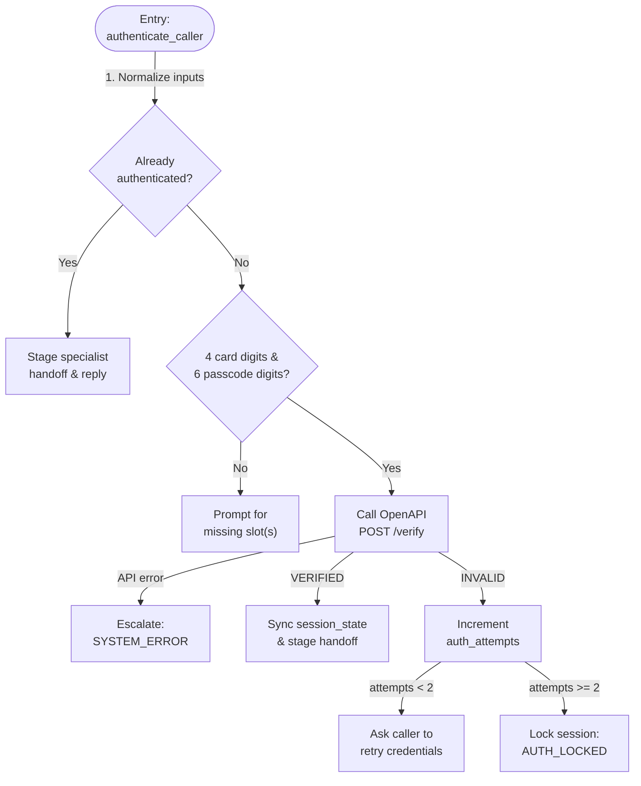

# Tool Specification: `authenticate_caller`

- **Owning Sub-Agent:** `authentication_agent`
- **Source Implementation:** [python_code.py](../../cxas_app/gecx-temporal-workflow-demo/tools/authenticate_caller/python_function/python_code.py#L1-L239)
- **OpenAPI Toolset Operation:** `tools.temporal_workflow_api_verify_caller` (`POST /v1/dispute-workflow/verify`)

## 1. Overview and Architectural Principles

The `authenticate_caller` tool serves as the security identity and verification gate for Albion Bank. It validates the caller's debit card last four digits and six-digit telephone banking passcode before any dispute workflow state can be started or inspected.

Core invariants:

- **Single-Question Slot Collection:** If either the four-digit card suffix or the six-digit passcode is missing or malformed, `_check_missing_slots` returns a clear prompt asking only for the missing field(s) without calling the backend API.
- **Two-Strike Lockout:** Consecutive failed verification attempts increment `session_state["auth_attempts"]`. On the second failed attempt, the tool sets `session_state["escalation_reason"] = "AUTH_LOCKED"` and `session_state["call_complete"] = "true"` and terminates the call politely.
- **Silent Handoff Staging:** Upon successful verification, the tool updates `session_state` (`authenticated=True`, `target_agent="dispute_specialist_agent"`, and `pending_dispute_init=True`). The shared `guard_and_route` callback then transfers silently to `dispute_specialist_agent` and automatically initiates `assist_card_dispute(operation="sync")` on the same turn.
- **Cross-Session Case Detection:** The tool records `has_active_case` and `case_ref` from `VerifyCallerResponse` inside `session_state` so `assist_card_dispute` can distinguish a returning caller resuming an existing dispute from a new dispute filing.

## 2. Complete Workflow Flowchart



## 3. Tool Signature and Parameters

```python
def authenticate_caller(
    card_last4: str = "",
    passcode: str = "",
) -> dict:
```

| Parameter | Type | Required | Description |
| :--- | :--- | :--- | :--- |
| `card_last4` | `str` | No | Last four digits of the caller's Albion Bank debit card, such as `"4821"`. |
| `passcode` | `str` | No | Six-digit telephone banking passcode spoken by the caller, such as `"195501"`. |

## 4. Sub-Flow Details and Session State Reads/Writes

### Helper Functions

- `_execute_verification(session, customer_id, card_last4, passcode)`: Builds the canonical `VerifyCallerRequest` payload, calls `_call_verify_api`, and delegates response handling to `_apply_verify_response`.
- `_build_verify_payload(customer_id, card_last4, passcode)`: Constructs the `VerifyCallerRequest` dictionary.
- `_apply_verify_response(session, body)`: Dispatches `VERIFIED` responses to `_sync_state_from_response` and failed credentials to `_handle_failed_attempt`.
- `_sync_state_from_response(session, body)`: Persists `authenticated=True`, `customer_id`, `customer_name`, `has_active_case`, and `case_ref` inside `session_state`, and stages `target_agent="dispute_specialist_agent"` plus `pending_dispute_init=True`.
- `_check_missing_slots(card_last4, passcode)`: Checks digit counts (`4` and `6`) and returns a natural spoken prompt when one or both values are missing.
- `_format_verified_reply(customer_name, has_active_case, active_case_ref)`: Returns the post-verification greeting without mentioning agent transfers.
- `_handle_failed_attempt(session)`: Increments `auth_attempts` in `session_state` and locks the session on the second failure.
- `_call_verify_api(payload)` / `_safe_json(resp)`: Invokes `tools.temporal_workflow_api_verify_caller` and validates the HTTP and JSON response envelope.
- `_escalate_system_error(session)`: Sets `escalation_reason="SYSTEM_ERROR"` and `call_complete="true"` inside `session_state`.

### `session_state` (`OBJECT`) Reads and Writes

| Key inside `session_state` | Direction | Purpose |
| :--- | :--- | :--- |
| `customer_id` | Read / Write | Defaulted via `app.json` (`"customer-claire-bristol"`) on new sessions and updated from `VerifyCallerResponse`. |
| `authenticated` | Read / Write | Set to `True` when `status == "VERIFIED"`. |
| `auth_attempts` | Read / Write | Integer counter (`0`, `1`, `2`) tracking consecutive failed attempts. |
| `customer_name` | Write | Verified customer full name (`"Claire Vance"`). |
| `has_active_case` | Read / Write | `True` when the customer already has a running Temporal dispute workflow. |
| `case_ref` | Read / Write | Active dispute case reference (`"DSP-2026-8841"`) when `has_active_case` is `True`. |
| `target_agent` | Write | Set to `"dispute_specialist_agent"` on verification success. |
| `pending_dispute_init` | Write | Set to `True` so `guard_and_route` auto-triggers `operation="sync"`. |
| `escalation_reason` | Write | Set to `"AUTH_LOCKED"` or `"SYSTEM_ERROR"` on terminal failure. |
| `call_complete` | Write | Set to `"true"` on terminal lockout or system error. |
